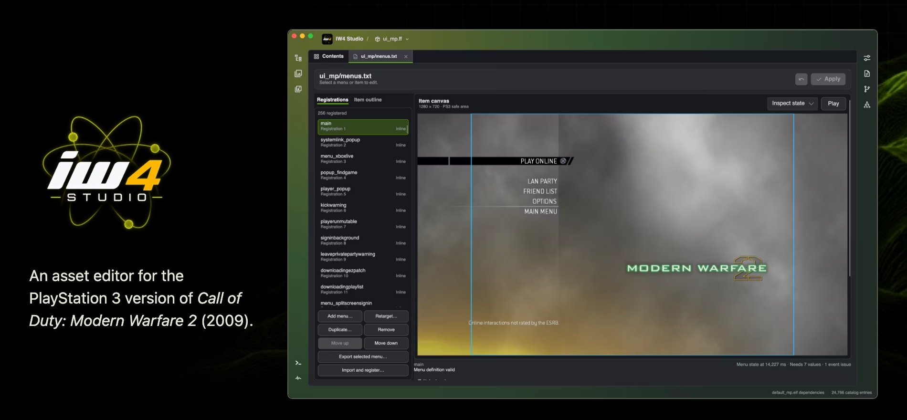
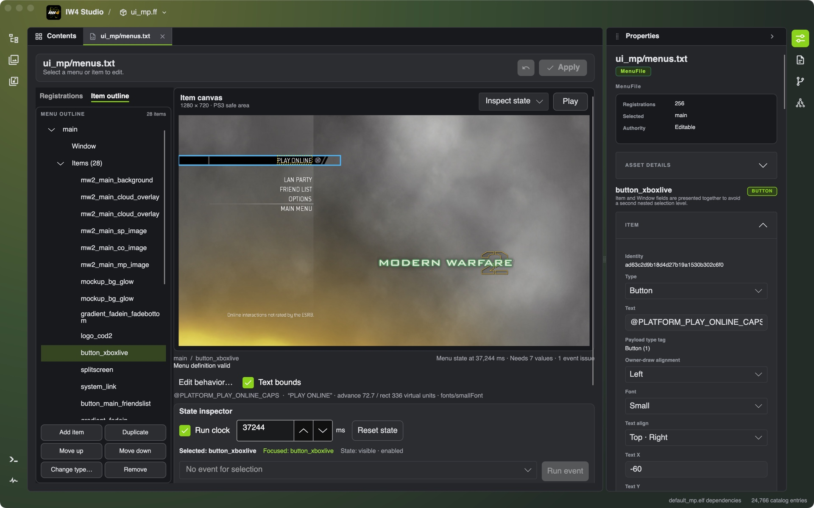
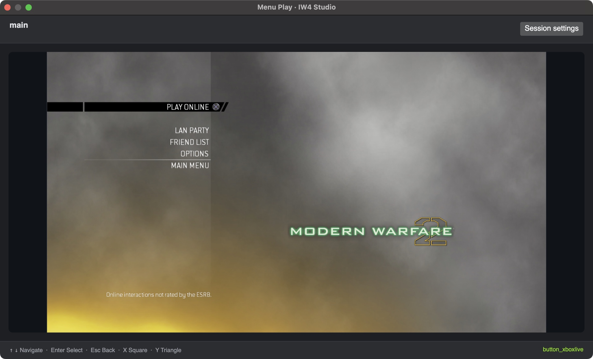
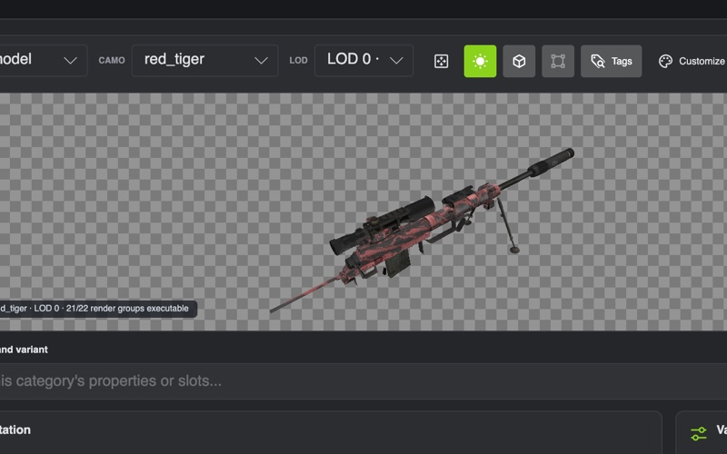
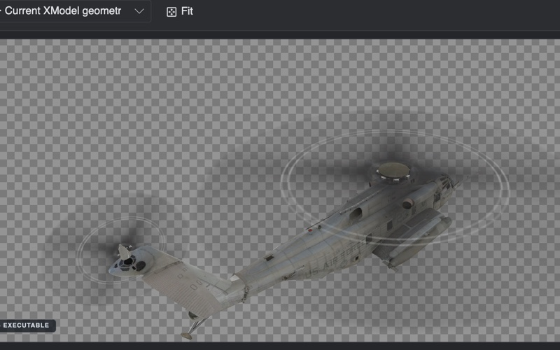
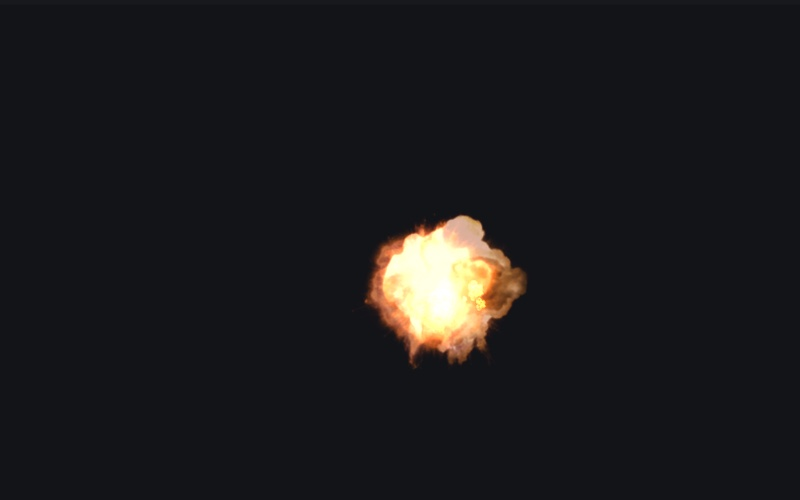

The main multiplayer menu from `ui_mp.ff`, open in IW4 Studio 1.2.98.

**[Download IW4 Studio](https://github.com/jacob-schroeder/IW4Studio/releases?q=iw4studio)** · Windows x64 · Apple Silicon · Linux x64

<table>
  <tr>
    <td width="50%" valign="top">
       
      <strong>Inspect a menu item</strong> 
      Select Play Online to see its text and alignment.
    </td>
    <td width="50%" valign="top">
       
      <strong>Preview the menu</strong> 
      Navigate the same menu in the Play window.
    </td>
  </tr>
</table>

## Explore the editors

<table>
  <tr>
    <td width="33%" valign="top">
       
      <strong>Weapon Editor</strong> 
      Preview Red Tiger camo on the Intervention and inspect its aiming settings.
    </td>
    <td width="33%" valign="top">
       
      <strong>XModel preview</strong> 
      Orbit the Pave Low helicopter and switch between its four levels of detail.
    </td>
    <td width="33%" valign="top">
       
      <strong>FX Editor</strong> 
      Replay the Pave Low explosion and inspect the seven layers that make up the effect.
    </td>
  </tr>
</table>

## What would you like to change?

<strong>Change a menu label</strong> · Localize

1. Open a copy of a PS3 fastfile that contains localized text.
2. Select an editable string in the **Localize** table, replace its value, and choose **Apply changes**.
3. Choose **File → Save As…** to write a new fastfile. Reopen that copy and search for the same string key to check the text.

<strong>Replace a menu graphic</strong> · Image

1. Open an editable **Image** asset and choose **Export PNG**.
2. Edit the PNG, choose **Replace image…** in Studio, and review the preview.
3. Apply the change and use **File → Save As…** to write a new copy of the fastfile.

<strong>Edit an existing GSC script</strong> · RawFile

1. Open a fastfile that contains an editable `.gsc` **RawFile**.
2. Open the script, change its source, and apply the edit.
3. Choose **File → Save As…**, then reopen the saved copy to inspect the source.

## Common questions

What file should I open?

Start with a copy of a PS3 MW2 fastfile (`.ff`). A fastfile packages game assets together. Studio’s asset list shows which ones your file contains.

Why is an image missing from the preview?

Some images depend on data outside the open fastfile. Keep its companion files available and choose **With dependencies** when reopening the fastfile so Studio can load its linked zones and streamed images.

Where did my changes go?

**Apply changes** updates the working copy in Studio. **File → Save As…** writes the modified fastfile to the location you choose.

<strong>Credits and related projects</strong>

- **SVDDENDEVTH** and **primetime43** contributed resources and assistance with `.self` files.
- **Red-EyeX32** and **aerosoul94** contributed reverse engineering documentation. [CoD Research](https://codresearch.dev/)
- **mo** and **Laupetin** contributed OpenAssetTools. [mo’s fork](https://github.com/michaeloliverx/OpenAssetTools/) · [OpenAssetTools](https://github.com/Laupetin/OpenAssetTools)
- **SwagSoftware** created [KisakCOD](https://github.com/SwagSoftware/KisakCOD).
- **EpikIzCool** helped with mapping and resources. **Fixed Username** contributed testing and ideas.
- **Infinity Ward** created the original COD4 SDK.

[PS3 binaries](https://github.com/jacob-schroeder/IW4-Binaries) · [IW4 Custom Maps](https://github.com/jacob-schroeder/IW4-Custom-Maps) · [Community mod catalog](https://forums.iw4studio.org/catalog)

